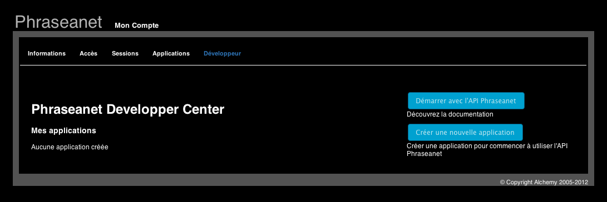
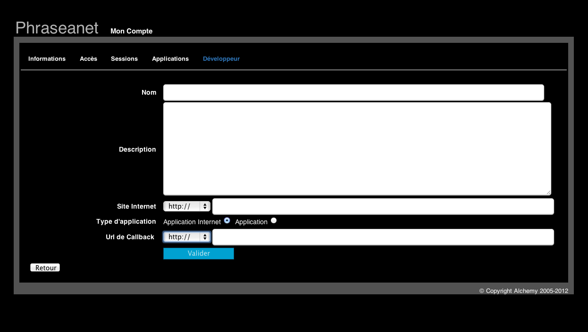
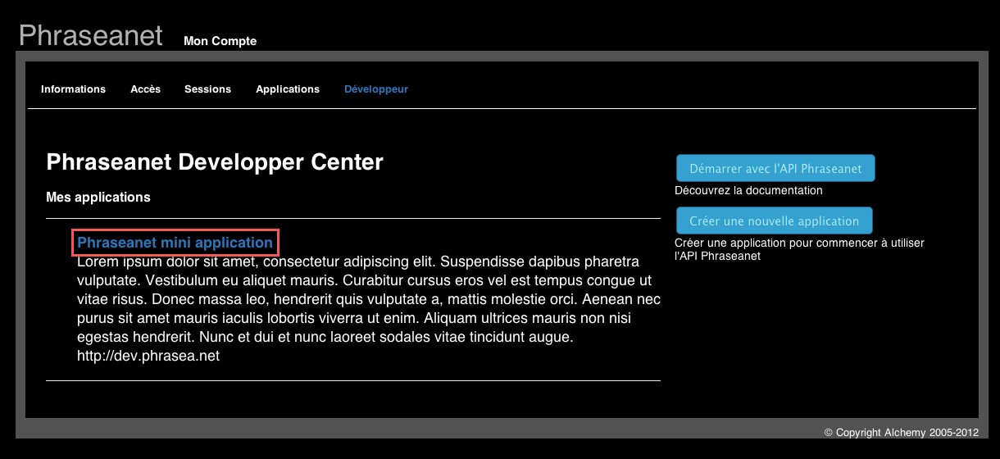
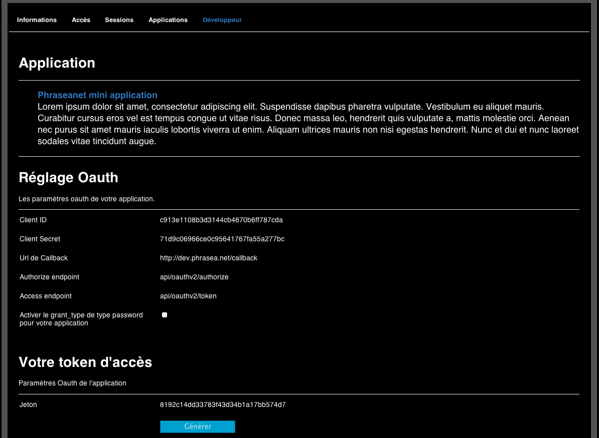

Créer des applications en utilisant l'API Phraseanet
====================================================

Phraseanet dispose d'une API publique, permettant aux développeurs d'intégrer
les documents (vidéos, photos etc ...) et fonctionnalités Phraseanet sur des
applications tierces.

* site internet
* application mobile
* application de bureau

Pour commencer :

* Lire la :doc:`documentation de l'API <index>` et bénéficier de l'aide
  de :doc:`l'équipe Phraseanet et de la communauté <Forums>`.

* Enregistrer une nouvelle application et obtenir une clé d'API.

Enregistrer une application auprés de l'API phraseanet
------------------------------------------------------

.. important::

    Depuis Phraseanet 4.2, l'espace *Développeur* n'est accessible qu'aux
    utilisateurs disposant du droit **Accès API** (et aux administrateurs).
    Sans ce droit, l'onglet *Développeur* n'est pas affiché et les pages
    ``/developers/...`` répondent par une erreur 403. Ce droit est attribué
    par un gestionnaire d'utilisateurs dans Admin, onglet **API** de la fiche
    utilisateur (voir :ref:`Accès API <Acces-API>`).

    Les jetons et applications existants continuent de fonctionner sans ce
    droit ; seules la création et la gestion des applications sont
    concernées.

Cliquer sur le login dans le :doc:`menu <../User/Manuel/General>` Phraseanet.

Dans la rubrique *Phraseanet mon compte*

Cliquer sur l'onglet *Développeur*

Cliquer sur *créer une nouvelle application*

* Donner un nom à l'application
* Remplir la description concernant l'application, cette information est à
  destination de l'utilisateur qui utilisera votre application, elle sera
  affiché sur la page d'authentification, veiller à être
  précis en expliquant brièvement le but de votre application.
* Remplir le champ du site internet de votre application, ce champ
  est obligatoire. Ce lien est présenté à l'utilisateur sur la page
  d'authentification à votre application
* Choisir le type d'application développée *application internet* ou
  *application de bureau*
* S'il s'agit d'une application internet, remplir le champ d'url de rappel
  Les utilisateurs authentifiés seront automatiquement redirigés sur cet URL
  aprés leur authentification

Une fois l'application enregistrée elle apparaît dans un tableau de bord

Le tableau de bord liste toutes les applications créées par l'utilisateur
authentifié.

Paramètres d'une application
----------------------------

Dans le tableau de bord des applications développeurs cliquer sur le nom d'une
application ; la page des paramètres de l'application s'affiche.

**Cette page présente**

* Le *Client ID* est un identifiant unique public de l'application
* Le *Client Secret* est un mot de passe privé de l'application afin d'identifier
  le propriétaire de l'application, ne jamais divulguer cette information.
* L'url de rappel de l'application, celle-ci peut être édité à tout moment
  en passant la souris dessus.
* Les points d'authentifiaction concernant l'autorisation et l'accès à l'API
* L'activation du grant_type password qui permet à votre application
  d'identifier les utilisateurs grâce à leurs identifiants Phraseanet

.. warning::

    N'utiliser le grant_type password que si et seulement si le propriétaire de
    la ressource à une grande relation de confiance avec l'application cliente.

* Le jeton d'accés développeur est le token qui identifie le propriétaire de
  l'application sur l'API phraseanet.

.. note::

    Le jeton développeur peut être utilisé lors du développement de
    l'application ou bien pour effectuer des requêtes sur l'API par
    l'intermediaire d'un processus automatisé qui ne nécessite pas
    d'authentification.

Droits appliqués aux appels de l'API
------------------------------------

Une requête sur l'API est exécutée avec les droits de l'utilisateur
authentifié par le jeton : l'API applique les mêmes droits par base et
collection que les interfaces Phraseanet (consultation, ajout, édition,
changement de status, suppression...). Une action non autorisée renvoie une
erreur HTTP 403.

Par exemple, depuis Phraseanet 4.2, les routes d'édition de reportage
:doc:`addrecords <API/V1/Route/Stories/AddRecords>`,
:doc:`delrecords <API/V1/Route/Stories/DelRecords>` et
:doc:`setcover <API/V1/Route/Stories/SetCover>` exigent le droit d'édition
sur la collection du reportage, et l'accès à chaque document ajouté.

.. seealso::

    Phraseanet s'appuie sur le protocole d'authentification oAuth2.0.
    Pour une meilleure connaissance des processus de création et
    d'authentification des applications clientes à l'API Phraseanet, consulter
    la RFC du protocole `Oauth2`_.

.. _Oauth2: https://datatracker.ietf.org/doc/html/draft-ietf-oauth-v2
