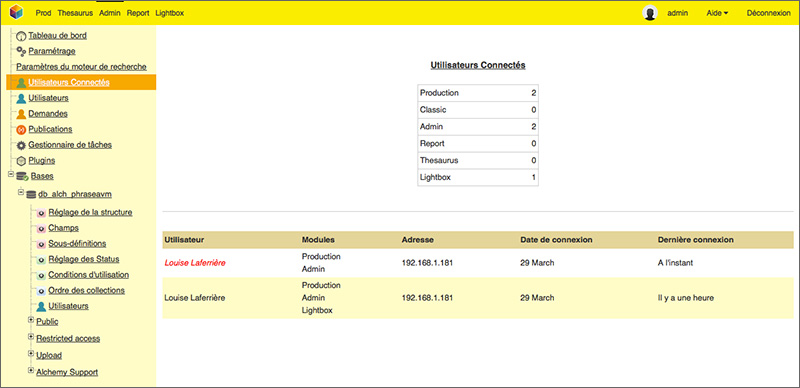
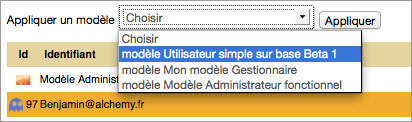
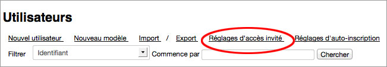
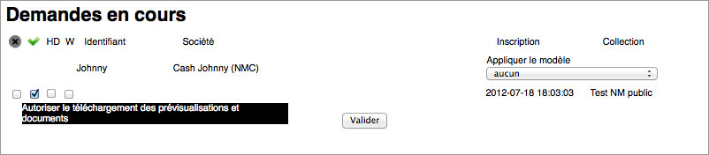

Gestion des utilisateurs
========================

.. toctree::
    :maxdepth: 3

.. topic:: L'essentiel

    Disponible pour les utilisateurs disposant des droits de gestion des
    utilisateurs, la rubrique Utilisateurs permet de gérer l'inscription,
    les droits et les informations sur les utilisateurs.

Cliquer sur la rubrique Utilisateurs pour accéder à l'interface de gestion des
utilisateurs.

Notions relatives aux utilisateurs et à leurs droits
----------------------------------------------------

Dans les interfaces de l'application, si un utilisateur ne voit pas certaines
fonctions ou rubriques, c'est qu'il n'a pas les droits requis pour y accéder.
Aussi, il n'est pas possible à un utilisateur disposant des droits de gestion
des utilisateurs de donner plus de droits qu'il n'en a lui-même lorsqu'il
procède à une inscription ou une modification de droits.

.. note::

    Un utilisateur n'ayant pas de droits attribués est un utilisateur fantôme.
    Il est signalé par une icône de fantôme dans la liste des utilisateurs.

    .. image:: ../../images/Administration-utilisateurfantome.jpg
        :align: center

Créer, modifier, supprimer un utilisateur
-----------------------------------------

Créer un nouvel utilisateur
***************************

* Cliquer sur le bouton **Nouvel utilisateur**
* Saisir l'e-mail de l'utilisateur puis cliquer sur Créer un utilisateur
* Attribuer des droits à l'utilisateur créé

.. seealso::

    :ref:`Se reporter à la section Edition des droits <Droits-Utilisateurs>`.

* Pour éditer les renseignements relatifs aux coordonnées de l'utilisateur,
  cliquer sur l'onglet Informations puis éditer le formulaire proposé
* Appliquer les modifications en cliquant sur le bouton Valider

.. note::

    Dans le cas d'utilisateurs créés par l'interface de gestion d'utilisateurs,
    l'adresse e-mail est utilisée comme identifiant.

Modifier les droits d'un utilisateur
************************************

* Double cliquer sur le nom d'utilisateur dans la liste
* Editer puis valider le formulaire

Supprimer un utilisateur
************************

* Sélectionner l'utilisateur dans la liste
* Cliquer sur le bouton Supprimer

Filtrer la liste des utilisateurs
---------------------------------

Il est possible de filtrer la liste des utilisateurs au moyen des critères
comme l’identifiant, le nom/prénom, l’email, le pays, ou la société.

La case **Utilisateurs avec une application API** restreint la liste aux
utilisateurs propriétaires d'au moins une application API.

Modèles utilisateurs
--------------------

Les modèles utilisateurs permettent d'appliquer des droits homogènes à un ou
plusieurs utilisateurs.
Dans la liste des utilisateurs, un modèle est repéré par une icône **M**.

Création de modèles utilisateurs
********************************

* Cliquer sur **Nouveau modèle**
* Donner un nom au nouveau modèle puis valider le formulaire
* Editer les droits du nouveau modèle puis valider le formulaire

.. note::

    Les modèles appartiennent aux utilisateurs qui les créent. Ils ne sont pas
    visibles par les autres administrateurs.

Appliquer des modèles aux utilisateurs
**************************************

Il est possible d'appliquer des modèles à un ou plusieurs utilisateurs.

* Sélectionner les utilisateurs
* Choisir le modèle à appliquer dans la liste des modèles
* Cliquer sur Appliquer

Une fenêtre d'alerte permet de choisir une option d'application du modèle :

* **Appliquer le modèle** : les droits du modèle se cumulent aux droits
  existants
* **Réinitialiser et appliquer le modèle** : les droits sont remis à 0 puis
  appliqués à l'utilisateur

L'accès invité
--------------

L'accès invité peut être mis en place, si souhaité. Il donne la possibilité à
des personnes non enregistrées d'accéder au fonds média.

Pour configurer l'accès invité :

* Cliquer sur le lien **Réglage de l'accès invité**

* Editer les droits du compte invité puis valider le formulaire

Dès lors qu'un droit est activé, le lien Accès invité figure sur la page
d’accueil de l’application.

.. _Droits-Utilisateurs:

Édition des droits
------------------

L'édition des droits concerne aussi bien les utilisateurs que les modèles.
Pour afficher le formulaire d'édition des droits d'un utilisateur ou d'un
modèle, double cliquer sur le nom de l'utilisateur ou du modèle dans la liste
des utilisateurs.

Le formulaire des droits permet d'attribuer des droits de consultation,
d'exploitation ou de gestion par bases et collections déclarées sur la
plateforme Phraseanet. Les droits sont accordés lorsque leurs cases
correspondantes sont cochées.

Le formulaire donne aussi accès aux informations de l'utilisateur. Cliquer
sur l'onglet fiche pour les afficher.

.. note::

    La modification des droits des utilisateurs peut se faire en lot en
    sélectionnant plusieurs utilisateurs.

Lors d'une édition par lot, une case grisée signifie que le droit est accordé à
au moins un seul des utilisateurs sélectionnés.
Un utilisateur ne peut pas donner plus de droits qu'il n'en a lui même : un
point rouge indique l'impossibilité de donner un droit.

Le signe **i** signale un formulaire secondaire. Cliquer sur l'icône pour
l'afficher.

Les entêtes de colonnes sont cliquables. Elles permettent de cocher ou décocher
les cases sur l'ensemble des collections d'une base.

Les droits de consultation
**************************

La partie gauche du formulaire de droits regroupe les droits d'accès et de
consultation :

* **Accéder** permet l'accéder à une base ou collection
* **Actif** pour activer le compte de l'utilisateur. Décocher la case désactive
  l'accès utilisateur sans perdre le paramétrage des autres droits
* **Paniers** autorise l'ajout de documents dans les paniers (déprécié)
* **Sous définition** autoriser la visualisation et le téléchargement des sous
  définitions de la classe *Sous résolution*
* **No Watermark** agit sur les filigranes appliqués aux sous définitions des
  documents de type image. Cocher la case pour supprimer le filigrane appliqué.
* Documents autorise le téléchargement du document original
* Commander autorise la commande de documents

D'autres options limitatives existent :

Limitation par les quotas
^^^^^^^^^^^^^^^^^^^^^^^^^

Quota permet de définir des limites de téléchargement par base ou par
collection. Cliquer sur l'icône des quotas pour paramétrer ces limites.

* Cocher **Restriction** pour activer les restrictions de téléchargement
* Saisir le nombre de téléchargements admis par mois pour la collection
* Cliquer sur le bouton Valider pour enregistrer le paramétrage et fermer
  la fenêtre

Limitation dans le temps
^^^^^^^^^^^^^^^^^^^^^^^^

Limite Temps définit un intervalle de date pendant lequel l'accès utilisateur
est valide.

* Cocher **Activer** pour activer le dispositif
* Remplir les dates de validité de l'accès puis soumettre le formulaire

Limitation par les Status
^^^^^^^^^^^^^^^^^^^^^^^^^

La limitation par les status permet de masquer des enregistrements à
l'utilisateur en s'appuyant sur les états d'un ou de plusieurs status.

.. note::

    Se reporter au paramétrage de la base pour la création et la gestion des
    status bits.

Cliquer sur l'icône des status pour paramétrer les restrictions d'accès aux
enregistrements.

* Cocher ou décocher les états de status limitant la visibilité des
  enregistrements puis soumettre le formulaire

Les droits d'exploitation et de gestion
***************************************

La partie gauche du formulaire de droits regroupe les droits d'exploitation des
documents et de gestion des bases et collections.

Droits sur les documents
^^^^^^^^^^^^^^^^^^^^^^^^

* Ajouter autorise l'ajout de documents et de reportages dans la collection
* Editer autoriser l'édition de la description des enregistrements
* Changer status autorise l'édition de status des enregistrements
* Supprimer autoriser la suppression d'enregistrements dans la collection
* Outils Images donne accès aux actions du bouton Outils
* Gestion Utilisateurs permet l'accès à la gestion des utilisateurs
* Consulter Rapports donne accès à Report
* Push autorise la diffusion de documents par Push et Validation

Droits sur la gestion des bases et collections
^^^^^^^^^^^^^^^^^^^^^^^^^^^^^^^^^^^^^^^^^^^^^^

Les droits de gestions s'imbriquent les un aux autres pour l'accès au
paramétrage des bases et des collections.

* Gestion Coll. révèle les menus donnant accès au paramétrage de la base
  dans Admin. Ce droits doit être complétés par au moins l'un des droits
  suivants.
* Gérer valeurs sugg. permet d'éditer les valeurs suggérées par champs et
  collection d'une base.
* Publication permet de publier avec Bridge et les Flux RSS disponibles
* Modif. Thésaurus permet d'éditer le thésaurus
* Gestion base donne accès aux fonctions de gestion de la base dont la création,
  la suppression ou la purge de bases
* Structure base donne accès au paramétrage de la structure d'une base

.. note::

    Pour utiliser **Bridge** l'utilisateur doit disposer des droits
    *Publication* et *Push*.

.. _Acces-API:

Accès API
---------

Depuis Phraseanet 4.2, la création d'applications et de clés d'API est
soumise au droit **Accès API**, attribué utilisateur par utilisateur.

Ce que contrôle le droit Accès API
**********************************

* Sans ce droit, l'onglet **Développeur** n'apparaît pas dans *Mon compte*
  et l'accès direct aux pages développeur (``/developers/...``) est refusé
  (erreur 403) : l'utilisateur ne peut ni créer, ni consulter, ni modifier
  d'application API, ni obtenir de jeton développeur.
* Les administrateurs de l'application ont toujours accès à l'espace
  développeur, que le droit leur soit attribué ou non.
* Le droit ne concerne que la **création et la gestion** des clés.
  Les jetons déjà émis continuent de fonctionner, et un utilisateur sans ce
  droit peut toujours se connecter à une application tierce qui utilise l'API
  (authentification oAuth2).
* Les appels à l'API restent soumis aux droits de l'utilisateur sur les bases
  et collections (consultation, ajout, édition, status, suppression...) :
  l'API ne donne pas plus de droits que ceux définis dans la rubrique
  :ref:`Édition des droits <Droits-Utilisateurs>`.

.. seealso::

    :doc:`Créer des applications en utilisant l'API Phraseanet <../../Devel/ApplicationDeveloper>`

Accorder ou révoquer l'accès API
********************************

* Double cliquer sur l'utilisateur dans la liste
* Cliquer sur l'onglet **API**
* En haut de l'onglet, sélectionner **Accès API accordé** ou
  **Accès API révoqué**

Le changement est enregistré immédiatement, sans avoir à valider le
formulaire.

.. note::

    Le droit Accès API est propre à chaque utilisateur : il ne fait pas partie
    des droits par collection et n'est pas transmis par l'application d'un
    modèle utilisateur. Un nouvel utilisateur n'a pas l'accès API par défaut.

L'onglet **API** présente également :

* la liste des applications API de l'utilisateur, avec la mention
  *propriétaire* pour celles qu'il a créées ou *utilisateur* pour celles
  auxquelles il s'est connecté ; pour chacune : identifiant, dates de
  création et de modification, activation du grant_type password, type
  d'application, URL de webhook et activation du webhook,
* la liste des codes d'autorisation oAuth2 émis pour l'utilisateur
  (application, URL de redirection, scope, date de création).

Mise à jour depuis une version antérieure
*****************************************

Pour ne bloquer personne lors de la mise à jour vers Phraseanet 4.2, le
patch de mise à jour attribue automatiquement le droit Accès API :

* à tous les administrateurs,
* à tous les utilisateurs propriétaires d'au moins une application API.

La liste des comptes concernés est écrite dans les logs de l'application
(lignes préfixées par ``[patch 4.2.0 / API access]``). Il est recommandé de
la relire après la mise à jour et de révoquer l'accès des comptes qui n'en
ont plus besoin.

Demandes d'accès
----------------

La rubrique **Demandes** liste les demandes d'inscription effectuées à partir
des formulaires disponibles.

Les inscriptions portent sur les collections et il y a autant de lignes que
d'accès demandés.

Un rollover sur le nom afficher les informations relatives au demandeur.

Choisir les droits à attribuer par collections en cochant les cases.

Les choix possible sont :

* Refuser l'accès à la collection demandée
* Donner accès à la collection demandée aux documents de type sous résolution
* Donner accès à la collection demandée, avec les documents en haute définition
* Donner accès à la collection demandée, sans les documents en haute définition

Cliquer sur Valider pour appliquer les choix faits.

L'autre possibilité d'accepter une demande d'inscription consiste à appliquer
un modèle utilisateur.
